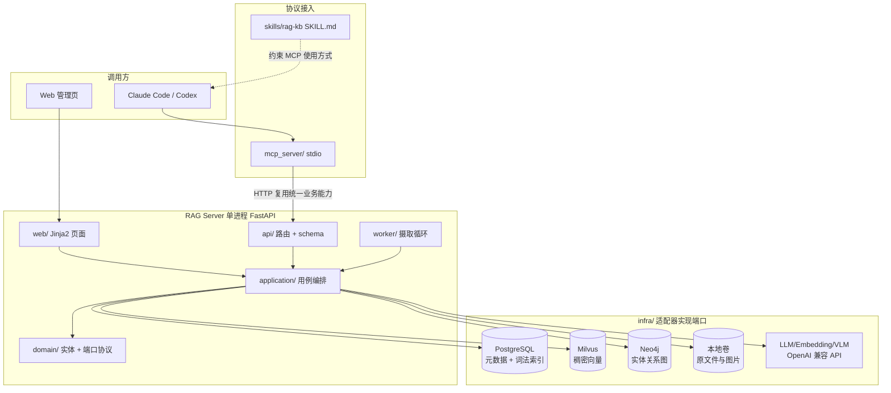

# RAG 工程师实践题 — 实施计划

> 依据：[RAG 工程师实践题.md](./RAG%20工程师实践题.md)
> 本机环境实测：Windows 11 / 内存 15.7 GB / 20 逻辑核 / Docker 29.6.2 + Compose v5.3.1（守护进程需手动启动）/ Python 3.12（uv 0.12.16）/ Node 22。
> 结论：资源足以承载「Postgres + Milvus standalone + Neo4j」四容器全栈，无需降级为单库方案。

---

## 1. 交付物与题目要求映射

先建立验收对照表，后续所有阶段以此为验收口径。

| 题目要求 | 交付物 | 里程碑 |
|---|---|---|
| 完整流程：建库→上传→解析索引→检索→回答 | Web 管理页 + REST API | M1–M4 |
| 以 Server 形式运行，非框架 | FastAPI 单进程 + WSGI 之外的显式分层 | M0 |
| 不使用 LangChain / LangGraph | 纯手写 pipeline，无编排框架依赖 | 全程 |
| Docker Compose 一键启动 + `.env.example` | `docker-compose.yml` + `Makefile` | M0 |
| 根目录 `AGENTS.md`（结构/边界/约束/命令/工作方式） | `AGENTS.md` | M0 |
| PDF + docx，含内嵌图片 | `infra/parsers/` 双适配器 + 图片抽取 | M2 |
| 图片进检索链路，且保留原文位置 | 多模态 caption + `doc_image` 表存 page/bbox | M2 |
| 分块与索引自设计（标题/段落/图片上下文/来源定位） | 见 §5.2 | M2 |
| 三种召回可实际调用 | `/api/kbs/{id}/search?mode=` | M3 |
| 图谱召回最小闭环（抽取→持久化→遍历→原文证据） | Neo4j + `graph_retriever` | M3 |
| 至少一种融合检索 + 重排决策说明 | RRF 融合 + 重排开关与取舍文档 | M3 |
| 检索限定知识库内 | `kb_id` 全链路过滤 + 隔离测试 | M3/M6 |
| 结果含来源、原文片段、召回信息 | `SearchHit` 结构统一返回 | M3 |
| 回答引用来源，Claude Code 演示 | `/api/kbs/{id}/ask` + MCP + Skill + 演示脚本 | M4/M5 |
| MCP Server + Skill，MCP 复用 Server 业务能力 | `mcp_server/`（HTTP 客户端）+ `skills/rag-kb/` | M5 |
| 分层、模块边界、数据流明确 | §4 依赖方向 + 设计文档 | M0–M6 |
| 注释解释设计原因/边界/取舍 | 编码规范写入 `AGENTS.md` | 全程 |
| 核心流程 + 三类边界测试 | `tests/`，见 §8 | M6 |
| 架构与设计文档 | `docs/architecture.md`、`docs/design.md` | M6 |
| 提交 GitHub + README 使用说明 | README 重写 | M6 |
| 加分：Benchmark 工具与优化分析 | `scripts/bench/` + 报告 | M7 |
| 加分：改进方案设计文档（待实现） | `docs/design-future.md` | M7 |

---

## 2. 技术选型

### 2.1 推荐栈

| 层 | 选型 | 理由 |
|---|---|---|
| 语言/包管理 | Python 3.12 + uv | 已 init，锁定版本；`uv.lock` 入库保证可复现 |
| Web 框架 | FastAPI + uvicorn + Pydantic v2 | 类型化契约、内置 OpenAPI，MCP 侧直接复用同源 schema |
| 元数据/词法检索 | PostgreSQL 16 | 一份库同时承担业务元数据与 BM25 词法召回，少一个组件 |
| 稠密向量 | Milvus 2.5 standalone（etcd + minio + milvus 三容器） | 原生 `partition_key` 实现库级隔离；与既有 Milvus 经验一致 |
| 图谱 | Neo4j 5.25 Community | 题目要求「抽取→持久化→遍历→回到原文」闭环，属性图最直接；社区版够用 |
| PDF 解析 | PyMuPDF（fitz） | 单库同时给文本块、`bbox`、内嵌图片、页码，来源定位成本最低 |
| docx 解析 | python-docx + lxml 遍历 | python-docx 拿不到图片在正文中的位置，需按 `w:drawing` 的 XML 顺序遍历块 |
| 中文分词 | jieba | 入库前分词，PG 侧用 `simple` 词典建 GIN 索引，规避 zhparser 编译 |
| Embedding / LLM / 多模态 | OpenAI 兼容 API：DeepSeek 生成 + Qwen MaaS 向量/多模态 | 题目允许 API，镜像无需背模型权重；端口化后可替换为本地 embedding |
| MCP | 官方 `mcp` Python SDK（FastMCP，stdio） | 传输简单，Claude Code 可直接 `command` 拉起 |
| 前端 | Jinja2 模板 + HTMX + 少量原生 JS | 无 Node 构建步骤，不增容器；题目明确前端美观非主评分项 |
| 摄取任务 | DB 任务表 + 单进程 asyncio worker 轮询 | 不引 Redis/RabbitMQ；`ingest_job` 表天然支持失败重试与状态查询 |
| 测试 | pytest + httpx AsyncClient + 分层 fake | 单测用 fake 端口，集成测跑真容器 |

### 2.2 被否方案与取舍

| 备选 | 否决原因 |
|---|---|
| pgvector 替代 Milvus | 组件少、部署更稳，但验收时「向量库」辨识度弱，且题目考察 RAG 工程设计，Milvus 的 partition/索引参数更能体现取舍。**保留为降级路径**：`VectorStore` 端口已抽象，断网或内存不足时可切 `PGVectorStore` |
| Elasticsearch / OpenSearch | BM25 与高亮确实更强，但多一个 1 GB+ 容器，换来的能力在单机 DEMO 里用不满 |
| Chroma / LanceDB | 单文件库，Docker 共享卷下并发写有坑，且不易演示「库级隔离」 |
| 图谱用 PG 递归 CTE | 少一个容器，但多跳查询与实体去重的 SQL 会显著拉高复杂度，Neo4j 的 `MATCH` 表达更贴合考点 |
| LangChain / LlamaIndex | 题目明令禁止 |
| React + Vite 前端 | 需 Node 构建阶段与静态托管，交付风险高于收益 |
| Celery + Redis | 单机 DEMO 引入的运维面大于收益；worker 抽成独立进程即可水平扩展 |

---

## 3. 系统架构



**依赖方向（单向，不得回指）**：`api` / `web` / `worker` → `application` → `domain`；`infra` 实现 `domain` 中定义的端口，由启动期注入。`domain` 不 import 任何 infra 模块——这条写进 `AGENTS.md`，并加一条 import-linter 或自写 AST 测试守住。

---

## 4. 目录结构

```
rag_system_demo_test/
├── AGENTS.md                  # 题目强制：结构/边界/约束/命令/Agent 工作方式
├── README.md                  # 最小版（M1）→ 完整版（M6）
├── docker-compose.yml         # app + postgres + etcd + minio + milvus + neo4j
├── .env.example               # 模型 API、各库连接串、检索默认参数
├── Makefile                   # up / down / migrate / demo / test / bench
├── pyproject.toml             # 依赖、CLI 入口、ruff/pytest 配置
├── src/rag_kb/
│   ├── main.py                # 应用装配：lifespan 建连接池、注入端口、拉起 worker
│   ├── config.py              # pydantic-settings，唯一配置入口
│   ├── cli.py                 # rag-kb migrate / demo / reindex（同一用例的 CLI 包装）
│   ├── domain/
│   │   ├── models.py          # KB / Document / Chunk / Entity / SearchHit / Citation
│   │   ├── ports.py           # MetadataRepository / VectorStore / LexicalIndex / GraphStore /
│   │   │                      # Embedder / LLM / VLM / Reranker / Parser / Storage
│   │   └── errors.py
│   ├── application/
│   │   ├── kb_service.py
│   │   ├── document_service.py    # 上传、状态机、删除级联、重试
│   │   ├── ingest_pipeline.py     # 解析→分块→图片描述→抽取→索引（可重入）
│   │   ├── search_service.py      # 三路召回 + 融合 + 重排开关
│   │   ├── qa_service.py          # 证据拼装、引用校验、无结果兜底
│   │   └── chunking.py            # 分块策略（纯函数，重点单测对象）
│   ├── infra/
│   │   ├── postgres/          # repository + 手写迁移 + stopwords_zh.txt
│   │   ├── milvus/store.py
│   │   ├── neo4j/store.py
│   │   ├── parsers/pdf.py, docx.py, base.py
│   │   ├── llm/openai_compat.py   # LLM / Embedding / VLM / Reranker 客户端
│   │   └── storage/local.py
│   ├── api/routers/           # kbs.py, documents.py, search.py, ask.py, health.py
│   ├── web/templates/, static/ # HTMX 本地文件，不引 CDN
│   └── worker/loop.py         # DB 任务表轮询，随 lifespan 启动
├── mcp_server/server.py       # 仅做 HTTP 转发，零检索逻辑
├── skills/rag-kb/SKILL.md     # 源文件；安装到 .claude/skills/rag-kb/
├── scripts/                   # 一次性/运维脚本 + bench/（migrate/demo 由 cli.py 承接）
├── tests/
│   ├── unit/                  # test_layering.py, test_config_compose_sync.py, ...
│   ├── integration/
│   └── e2e/ + fixtures/
└── docs/
    ├── RAG 工程师实践题.md
    ├── 实施计划.md
    ├── 技术选型文档.md
    ├── 项目任务清单.md
    ├── 项目目录结构说明.md
    ├── 文档修订任务清单.md
    ├── mcp-setup.md           # 待建（M5）
    ├── demo.md                # 待建（M5）
    ├── architecture.md        # 待建（M6）
    ├── design.md              # 待建（M6）
    ├── design-future.md       # 待建（M7）
    └── benchmark.md           # 待建（M7）
```

> **注意**：`docs/` 的 gitignore 问题已在 M0-01 解决；新增目录或文档时，同一 commit 内更新
> `docs/项目目录结构说明.md`，不要等收尾再补。

---

## 5. 核心设计

### 5.1 数据模型

**PostgreSQL**

| 表 | 关键字段 | 说明 |
|---|---|---|
| `kb` | id, name, description, created_at | 知识库 |
| `document` | id, kb_id, filename, mime, sha256, size, status, error, page_count, chunk_count, chunker_version, embed_model, created_at, updated_at | `status ∈ pending/parsing/chunked/indexing/ready/failed`（ADR-017）；`unique(kb_id, sha256)`；`chunker_version` / `embed_model` 用于判断是否需要重建 |
| `doc_image` | id, kb_id, doc_id, seq, page_no, bbox, file_path, caption | 图片与原文位置的绑定，`seq` 保证阅读顺序；`page_no/bbox` 对 docx 为 NULL。反查走 `chunk.image_id`，不重复存 `chunk_id` |
| `chunk` | id varchar(32), kb_id, doc_id, parent_id, level, kind, content, heading_path text[], page_no, page_to, bbox jsonb, char_start, char_end, seq, token_count, image_id, meta jsonb, chunker_version | `level ∈ parent/child`；**只有 `child` 进索引**；`kind ∈ text/image/table`；`meta` 存低权重/降级标记（如 VLM 占位），不参与过滤；`unique(doc_id, seq)`；`index(kb_id, doc_id)` |
| `chunk_lex` | chunk_id, lex_tokens（jieba 结果空格连接）, tsv tsvector | 只存子块；`tsv` 为 `GENERATED ALWAYS AS (to_tsvector('simple', lex_tokens)) STORED`；GIN 索引 |
| `ingest_job` | id, doc_id, stage, status, attempts, error, timings jsonb, claimed_at | 失败可重试、耗时可见；worker 用 `FOR UPDATE SKIP LOCKED` 领取 |
| `query_log` | id, kb_id, mode, query, latency_ms, hit_ids jsonb, channels jsonb, rerank, tokens, created_at | 排查与 benchmark 数据来源 |

> 实体与关系**只存 Neo4j**（ADR-020），PostgreSQL 不再有实体注册表与实体-块关联表。
> 所有子表外键 `ON DELETE CASCADE`；删除级联清单见 ADR-020：PG 行 → Milvus 向量 →
> Neo4j 节点/边 → 磁盘图片，验收口径是"三通道计数为 0 + 磁盘文件不存在"。

**Milvus**：单 collection `chunk_vec`，字段 `id / kb_id(partition key) / doc_id / level / vector(dim=1024)`；只写 `level=child` 的子块。索引 `HNSW(COSINE, M=16, efConstruction=200)`，检索 `ef=64`。

`partition_key=kb_id` 是**路由能力**，不是隔离边界：查询带 `kb_id` 等值过滤时只扫对应分区，不带过滤时仍会扫描全部分区。因此端口实现必须强制注入过滤，并由隔离测试兜底（ADR-004）。集成测试在写入/删除后先 `flush()` 或使用 Strong 一致性再断言，避免"删除后仍命中"的假失败。

**Neo4j**：节点 `(:Doc {kb_id, doc_id})`、`(:Chunk {kb_id, chunk_id, level})`、`(:Entity {kb_id, name, normalized, type})`；关系 `[:MENTIONS {span}]`（Chunk→Entity）、`[:REL {type, weight, chunk_id, evidence_span}]`（Entity→Entity，带出处）。唯一约束 `Entity(kb_id, normalized, type)`；每条查询的每个节点都带 `{kb_id: $kb_id}`。

**关系的 `chunk_id` 指向可检索的子块**：抽取时按 `evidence_span` 与子块 `char_start/char_end` 的字符交集映射，取覆盖最多者；无交集才退回父块并在结果中标记 `level=parent`（ADR-018）。父块可作为证据节点存在，但关系边优先指向子块。

### 5.2 解析与分块

1. **块序列化**：两个 parser 统一输出 `Block(type, text, page_no, bbox, heading_level, image_ref, seq, char_start, char_end)` 的**有序**列表，图片作为独立 block 插在原位置。这是「图片位置对应关系」的根：
   - `seq` 严格单调递增，表示阅读顺序；`char_start/char_end` 是相对文档正文串联文本的偏移，两种格式都必填；
   - `page_no/bbox` 对 PDF 必填，对 docx 为 NULL（不渲染就没有页码与坐标）；
   - PDF：`page.get_text("dict")` 取文本块，按页内 y→x 排序，字号与 `heading_level` 推断标题；`get_images()` + `get_image_bbox()` 取图与位置；过滤 `< 120×120 px` 或 `< 8 KB` 的装饰图。整份 PDF 无文本块时抛"不支持 OCR"的领域异常，文档置 `failed`，不产生空 chunk；
   - docx：按 body 的 `w:p` / `w:tbl` 顺序遍历，`w:drawing` 内的 `r:embed` 去 `document.part.related_parts` 取 blob；样式名 `Heading N` 或 `outline_level` 定标题层级；`char_start/char_end` 基于段落与表格文本按 XML 顺序串联后的全文计算；页眉/页脚中的图片不在范围内（已知限制）。
2. **标题树**：用 heading 序列构建 `heading_path`（存储为 `text[]`，如 `["产品手册","3 部署","3.2 依赖"]`）。标题文本以 `heading_path` 拼接后写入子块前缀，解决"块脱离上下文后语义破碎"。标题块本身不单独成块（除非该节没有正文），其文本只作为后续块的前缀。
3. **父子双层**（ADR-018）：
   - 父块 = 一个二级标题下的整节，目标 ≤ `PARENT_MAX_TOKENS`；**超过上限时按段落边界二次切分**，得到多个 `level=parent` 的块，共享同一 `heading_path`，`seq` 连续；
   - 无标题文档：以文档根为父块，按 `PARENT_MAX_TOKENS` 在段落边界切分，`heading_path=[]`；
   - 子块 = 段落在父块内贪心打包，目标 `CHUNK_TARGET_TOKENS`，重叠 `CHUNK_OVERLAP_RATIO`（默认 15%），按句子边界切、不切断句子；
   - **子块不跨父块生成**：若按重叠比例回退时越过父块起点或终点，只保留父块内的重叠部分；父块外的字符由相邻父块自己的 `char_start/char_end` 表示，不复制进本子块；
   - 只有子块进向量/词法索引；检索命中子块，回答阶段回填父块。取舍：索引量约 +10%，换取小块向量纯度与父块上下文完整度。
4. **图片块**：`content = 【图片】{VLM 生成的描述}\n【上下文】{前一段尾 200 字} + {后一段首 200 字}`，`kind=image`，`parent_id` 指向所在小节的父块，`image_id` 指向 `doc_image.id`。原图落盘；PDF 用 `page_no + bbox` 定位，docx 用 `seq + 前后段落` 定位。
   - VLM 关闭或单图描述失败时，`content` 退化为 `【图片】未生成描述（VLM 不可用）` + 上下文，并在 `chunk.meta` 写 `{"caption_status":"placeholder","low_weight":true}`；检索融合时对 `low_weight` 的块降权，而不是把它排除（图片仍须进入可检索链路）。
5. **表格**：简单表线性化为 Markdown 文本，作为 `kind=table` 的块随所在小节入父块；跨页表按页拼接并记录 `page_no/page_to`；合并单元格只保留文本，不还原网格。复杂表格、公式与版式不保证还原，已列为已知限制。
6. **版本与重建**：任何分块参数（`CHUNK_TARGET_TOKENS`、`CHUNK_OVERLAP_RATIO`、`PARENT_MAX_TOKENS`）或切分规则变化，都必须递增 `chunker_version`；`reindex` 依据该版本判断是否需要重建，禁止在旧版本数据上混跑新规则。

### 5.3 图谱抽取（题目硬性闭环）

- **抽取范围**：只对 `level=child AND kind=text` 的子块抽取。图片块的 `content` 是 VLM 描述而非原文，若参与抽取，`span` 在原文中必然找不到，会被校验全部丢弃；表格块同理先不抽取。这是"图片实体"看起来很多、入库却为零的根因，直接排除比事后补救更可靠。
- **抽取方式**：逐子块调用 LLM，输出受 schema 约束的 JSON：`entities[{name, type, span}]`、`relations[{head, relation, tail, evidence_span}]`。`type` 走白名单（人物/组织/产品/指标/流程/条款/地点…），`relation` 走闭集 + `OTHER` 兜底；提示词要求 `span` 必须逐字摘自输入块。
- **校验**（压低幻觉入库率的关键）：
  1. `span` 先做原文精确子串匹配；失败再用"去空白/全角半角归一"后的文本匹配；仍失败则丢弃该条；
  2. 丢弃数量写入 `ingest_job.timings`（如 `graph_dropped_spans`），不算文档失败；
  3. 实体归一：全角转半角、统一小写、去掉成对括号内的补充说明；归一冲突时保留出现频次最高者，频次相同保留首次出现者。
- **证据映射**：抽取以子块为单位，关系边的 `chunk_id` 默认就是当前子块；若后续改为按父块批量抽取，则用 `evidence_span` 的字符区间与子块 `char_start/char_end` 求交集，取覆盖字符最多的子块；无交集才退回父块并在结果标记 `level=parent`（ADR-018）。跨子块的实体通过归一后的实体节点自然连起来，不强行合并证据。
- **持久化**：实体与关系只写 Neo4j（ADR-020）：`(:Entity {kb_id, name, normalized, type})`、`[:MENTIONS {span}]`、`[:REL {type, weight, chunk_id, evidence_span}]`；唯一约束 `Entity(kb_id, normalized, type)`。边上的 `weight` 默认 `1.0`（提示词未给置信度时），保留字段供后续标定。
- **检索闭环**：
  1. 查询侧 jieba 分词并归一，调用 `GraphStore.candidate_entities(kb_id, terms)` 取候选，按"精确 → 别名 → 2-gram 模糊"三档排序，取前 `GRAPH_SEED_LIMIT` 个作为种子；
  2. 从种子出发做 1..`GRAPH_MAX_HOPS` 双向展开：**路径上的每个节点都带 `{kb_id: $kb_id}`**，每个种子的邻居数受 `GRAPH_NEIGHBOR_LIMIT` 限制，路径去重后再取边；
  3. 取关系边上的 `chunk_id` 集合，回 PostgreSQL 按 `kb_id + chunk_id` 取**原文子块**；
  4. 打分：`path_score = Π edge_weight × 1/(1+hops)`，子块的图为 `Σ path_score`（同一子块被多条路径命中则累加），再按结果集内最大值归一化；
  5. **返回的是原文块，不是三元组**——这是「仅展示关系图不算完成」的分界线。
- **职责边界**：种子链接、2-gram 模糊匹配、路径打分与融合都在 `application/search_service.py`；`infra/neo4j/store.py` 只实现"候选实体查询、多跳展开、按 doc 删除、计数"等执行能力，避免把检索算法埋进 infra（ADR-019）。
- **成本与失败**：抽取只在 ingest 期做一次，查询期零 LLM 调用；调用次数约等于子块数，受 `LLM_MAX_CONCURRENCY` 限制。单批 JSON 解析失败按"丢弃该批并计入 timings"处理，不重试到超时；若 LLM 整体不可用导致图谱为零，文档按 ADR-022 置 `failed`，可重试。

### 5.4 检索与融合

四种模式：`mode=vector|keyword|graph|hybrid|hybrid_weighted`，单通道 `top_k` 默认
`RETRIEVAL_TOP_K=20`，返回前按 `top_k` 截断。

| 通道 | 实现 | 说明 |
|---|---|---|
| 向量 | Milvus HNSW，**强制 `kb_id` 等值过滤**，只查 `level=child` | 语义相似，跨表述；`partition_key` 只负责路由，过滤由端口层强制注入（ADR-004） |
| 关键词 | PG：查询侧 jieba 切词 → 清洗 → `to_tsquery('simple', 'a \| b')` + `ts_rank_cd`，GIN 加速 | 精确术语、编号、专有名词；`simple` 词典避免中文分词器编译 |
| 图谱 | §5.3 闭环 | 关系型推理问题；返回原文子块 |

**关键词通道的清洗规则**（不写清楚就会踩 SQL 语法错误）：

1. jieba 切词后，只保留中文、字母、数字、下划线；丢弃标点、空白与纯符号；
2. 去掉中文停用词（表在 `infra/postgres/stopwords_zh.txt`），单字是否保留由停用词表决定，不按长度硬删；
3. 清洗后 token 用 ` | ` 连接再拼 `to_tsquery('simple', ...)`；`& | ! ( ) : * '` 等特殊字符不得出现在 token 中；
4. 清洗后为空则直接返回空结果，不抛 SQL 错误；
5. 已知短板保留：`ts_rank_cd` 不是 BM25，无字段加权与同义词扩展，由 §9 benchmark 量化差距。

- **融合**：默认 **RRF（k=60）**。理由：三路分数量纲不可比（余弦、`ts_rank_cd`、图路径分），RRF 只用排名，无需调权重即可稳定优于单路。
  - 去重键是 `chunk_id`：同一子块被多路命中时只保留一条，合并 `channels[]` 并累加 RRF 分；
  - 父块回填发生在回答阶段（§5.5），检索阶段返回的始终是子块；
  - 加权融合保留为 `mode=hybrid_weighted`，权重取 `HYBRID_WEIGHT_VECTOR / HYBRID_WEIGHT_KEYWORD / HYBRID_WEIGHT_GRAPH`（默认均为 1.0），作为与 RRF 对照的实验分支。
- **重排**：默认 `rerank=off`。
  - `rerank=on`：对融合后 top-30 走 cross-encoder（`bge-reranker-v2-m3` 兼容 API），配置键见 ADR-021；
  - `rerank=llm`：显式选择 LLM listwise，属于对照实验，不在默认路径；
  - 取舍：RRF 已解决"分数不可比"，重排要证明"在已融合的 top-k 里还能排得更好"；引入 100–300 ms 延迟与额外成本，收益需由 §9 benchmark 的 nDCG@10 差值说话。
- **一致性**：Milvus 写入/删除后，集成测试先 `flush()` 或使用 Strong 一致性再断言；否则"删除后 0 命中"会偶发失败。
- **统一返回** `SearchHit`：`chunk_id, doc_id, doc_name, level, page_no, heading_path, snippet, image_url, score, channels[], debug{rank_per_channel, raw_score}`。
  - `chunk_id` 是子块 id；`level=parent` 只出现在图谱证据无法映射时的回退；
  - `page_no` 统一命名（不再用 `page`）；`image_url` 对图片块返回原图地址；
  - `channels[]` 记录命中的通道，`debug` 记录各通道排名与原始分，用于排查"某一路是否真的起作用"。

### 5.5 回答与引用

- **证据拼装**：
  1. 检索返回子块；按 `chunk.parent_id` 取父块作为证据正文，同时保留命中的子块 id 用于回溯；
  2. 证据总预算为 `QA_MAX_CONTEXT_TOKENS`（默认 6000）。超出时按融合分**从低到高丢弃整条证据，不截断单条**；启动期校验 `QA_MAX_CONTEXT_TOKENS >= PARENT_MAX_TOKENS`，避免单条父块天然超预算；
  3. 每条证据带编号 `[n]`、文档名、页码（docx 用段落序号 `seq`）、标题路径；编号与排序后的证据一一对应。
- **LLM 调用边界**：检索、融合阶段零 LLM 调用（`rerank=llm` 为调用方显式选择的例外）；只有 `/ask` 的证据生成阶段调用 LLM。
- **引用回校验**：`qa_service` 强制模型输出 `answer + citations[]`，引用编号必须落在 `[1..n]`；越界编号直接剔除；若剔除后没有有效引用且答案仍含实质结论，降级为拒答——不允许保留无来源结论。
- **引用格式**：PDF 为 `《文档名》第 N 页 · 标题路径`；docx 为 `《文档名》段落 #seq · 标题路径`（没有页码就不伪造页码）。
- **无证据兜底**：按固定话术拒答（"知识库中未找到足够依据"），回传 `no_evidence=true`、`attempted_channels[]` 与已尝试的查询改写——Skill 侧据此决定换词重试一次或如实告知。
- **演示形态**：「基于证据回答」走 Claude Code：MCP 的 `search` 返回证据，回答由 Claude Code 生成；Server 侧 `/ask` 作为无 MCP 环境的等价能力。

---

## 6. 对外接口

**REST**（`/api` 前缀，OpenAPI 自动生成）

| 方法 | 路径 | 说明 |
|---|---|---|
| POST / GET | `/kbs` | 建 / 列知识库 |
| GET / DELETE | `/kbs/{id}` | 查 / 删知识库（删除级联见 ADR-020） |
| POST / GET | `/kbs/{id}/documents` | 上传（multipart）/ 列表 |
| GET / DELETE | `/documents/{id}` | 详情（状态、进度、错误）/ 删除 |
| POST | `/documents/{id}/retry` | 重试失败文档：状态回 `pending`，`attempts+1`，先清理残留 |
| POST | `/kbs/{id}/reindex` | 从 `chunk` 表重建三路索引（换 embedding 模型 / 分块参数 / M2 存量数据），返回 `202` 与任务 id |
| GET | `/documents/{id}/chunks` | 查看分块结果：`level / page_no / page_to / bbox / char_start / char_end / token_count` |
| GET | `/documents/{id}/images/{img_id}` | 原图；响应头带 `X-Page-No` / `X-Bbox` / `X-Seq` 供前端定位 |
| POST | `/kbs/{id}/search` | `{query, mode, top_k, rerank}` → `SearchHit[]` |
| POST | `/kbs/{id}/ask` | `{question, mode, top_k}` → `{answer, citations[], no_evidence, attempted_channels[]}` |
| GET | `/kbs/{id}/graph` | 实体子图（演示用，非召回路径） |
| GET | `/healthz`, `/readyz` | 进程存活 / 三存储连通性 + 模型配置状态 |

**写入口的状态与错误码**：

| 场景 | 状态码 | 说明 |
|---|---|---|
| 超限文件 | `413` | 不建 document 行、不落盘 |
| MIME / 扩展名 / magic bytes 不符 | `415` | 同上 |
| 同库 `sha256` 重复 | `409` | 响应携带已有 `document_id` |
| 请求 schema 不合法 | `422` | Pydantic 校验 |
| 文档 / 知识库不存在 | `404` | — |
| `mode=graph` 时 Neo4j 不可用 | `503` | `hybrid` 降级并在 `channels[]` 标 graph=error |
| 解析 / embedding / 图抽取失败 | 接口仍 `200`，文档 `status=failed` | 失败是异步任务结果，不是 HTTP 错误 |

> `reindex` 的对外唯一入口是 REST；`rag-kb reindex` 只是同一用例的 CLI 包装，不构成第二套实现。

**MCP 工具**（stdio，全部转发到上面同一套 REST）

- `list_knowledge_bases()` → `[{id, name, description, doc_count, ready_count}]`
- `search_knowledge_base(kb_id, query, mode="hybrid", top_k=8)` → 带来源、页码/段落、标题路径与 `channels[]` 的证据列表
- `ask_knowledge_base(kb_id, question, mode="hybrid")` → 带引用的回答

启动方式：`uv run --extra mcp rag-kb-mcp`（`mcp` 为可选依赖，入口在 `pyproject.toml` 声明）。

**Skill**（源文件 `skills/rag-kb/SKILL.md`，安装到 `~/.claude/skills/rag-kb/` 或项目 `.claude/skills/rag-kb/`）必须写明：

- 何时调用：涉私有文档的事实性问题；
- 如何选库：先 `list_knowledge_bases`，按名称/描述匹配；多候选或不匹配时向用户确认，不猜测；
- 引用格式：PDF 用 `《文档名》第 N 页 · 标题路径`，docx 用 `《文档名》段落 #seq · 标题路径`；
- 无结果处理：改写关键词重试一次 → 如实告知并列出已检索的知识库。

---

## 7. 里程碑

| 阶段 | 内容 | 验收标准 |
|---|---|---|
| **M0 骨架与部署**（0.5–1 天） | 修 `.gitignore`；compose 六服务 + 健康检查；`.env.example`；`AGENTS.md`；Makefile；配置层；**提交骨架（M0-15）** | `cp .env.example .env` 填 key 后 `make up`，`/readyz` 的 postgres/milvus/neo4j 三项 green；模型三项 `required=false`；三库可连；代码已进版本库 |
| **M1 知识库与文档管理**（1.5–2 天） | KB/Document CRUD、上传落盘、状态机、Web 页面；**PG 连接池与端口注入、分层测试、配置同步测试、最小 README** | Web 上建库、传文件、看状态、删库删文档全通；`test_layering` 与 `test_config_compose_sync` 通过；删库级联 |
| **M2 解析分块与图片**（2.5–3.5 天） | 双 parser、Block 序列、标题树、父子分块、图片 caption、`/chunks` 可视化；worker 在 lifespan 启动；tombstone / 重试接口 / CLI 入口 | 含图 PDF 与 docx 解出正确 `heading_path`；docx 的 `page_no/bbox` 为 NULL 且 `char` 偏移正确；图片块带 `image_id` 与定位；文档终态为 `chunked` |
| **M3 三路召回与融合**（3–4.5 天） | Milvus 索引、PG 词法索引、图谱抽取+校验+持久化+遍历、RRF、`/search` + debug；**reindex 回填、Milvus 写读删冒烟** | 同一问题分别用 vector/keyword/graph/hybrid 返回各自结果；图谱路径能反查到原文子块；跨库检索为空；M2 存量 `chunked` 文档可回填到 `ready` |
| **M4 回答与引用**（1–1.5 天） | 证据拼装与上下文预算、引用回校验、拒答兜底、`/ask` | 回答每条结论有 `[n]` 且编号合法；无依据时明确拒答；`QA_MAX_CONTEXT_TOKENS` 生效 |
| **M5 MCP + Skill + 演示**（1.5–2 天） | MCP 三工具与 `mcp` 可选依赖、Skill 安装说明、Claude Code 配置与演示脚本、演示数据 | Claude Code 内 `list → search → 引用作答` 全流程跑通；MCP 不 import `rag_kb`、无独立检索实现；Skill 从 `.claude/skills/` 生效 |
| **M6 测试与文档**（2–3 天） | 单测/集成/e2e 补齐、三类边界、`architecture.md`、`design.md`、README | 测试全绿；三类边界均有用例；文档能支撑"讲清每个取舍"的答辩 |
| **M7 加分项**（1.5–2 天） | benchmark 脚本与报告、`design-future.md` | 可复跑的指标表 + 至少 3 个待实现方案；开跑前 chunking 与 chunk_id 规则已冻结 |

> **节奏**：合计约 12–19 人日（M2/M3 已含约 50% buffer），M0/M1 的实际耗时可校准后续估算。
> **并行关系**：M1 内部串行（模型 → 迁移 → 仓储 → 用例 → 路由）；M2 的 parser 与 fixture 可在
> M1-05（存储）完成后并行，但不能提前于 M1-02（端口）与 M1-03（迁移）。
> **发布闸门**：M5 结束设一道"题目硬要求全绿"的检查——三种召回可调用、图谱回到原文、
> 引用合法、知识库隔离、删除后三通道 0 命中。通过后 M6/M7 可按剩余时间压缩，而不是反过来
> 用测试或加分项挤占主线。

---

## 8. 测试计划（题目点名三类边界）

**单元（fake 端口，无容器，快）**
- `chunking`：标题树构建、超长段落切分、重叠不丢句、图片块上下文拼装、空文档、单段落无标题
- `entity_extract`：span 校验丢弃幻觉、实体归一、类型不在白名单时降级
- `fusion`：RRF 分数与去重、单通道缺结果时不崩
- `citation`：越界引用剔除、无证据走拒答分支
- `parsers`：固定 fixture 的块序与 bbox 断言

**集成（真容器）**
- 全链路：建库→上传 PDF/docx→轮询到 `ready`→三路检索→`/ask` 引用合法
- **知识库隔离**：A 库文档对 B 库检索三通道均零命中；A/B 同名词不串
- **处理失败**：①超限文件 → 上传返回 413 且不建 document 行；②损坏文件 / 无文本 PDF / 注入 parser 异常 / 空 `EMBED_API_KEY` → `status=failed` + `error` 可读，`ingest_job` 记录 stage，重试可恢复；③失败文档不产生 chunk/向量/图/词法残留（用计数断言）
- **删除后不可召回**：删文档/删库后 vector + keyword + graph 三通道均 0 命中；图片文件与 Milvus 实体、Neo4j 节点均已清理（用计数断言，不只靠接口 200）

**e2e**：MCP 走 stdio 拉起，跑 `list → search` 两个工具；Web 用 httpx 跑表单流。

---

## 9. 加分项设计

**Benchmark（`scripts/bench/`）**
- 数据：**20–30 条** QA 样本（`tests/fixtures/bench/qa.jsonl`），每条包含：
  `id / question / type / gold / reference_answer`；
  - `type ∈ single_hop / multi_hop / term / image / unanswerable`；
  - `gold` 为 `[{doc_id, page_no, char_start, char_end}]`（或页面级），**不使用 `chunk_id`**；
  - `unanswerable` 题用于衡量拒答准确率。
- 指标：检索侧 `Recall@5/@10`、`MRR`、`nDCG@10`（按证据区间与金标区间的重叠率或页码命中计算）；生成侧引用命中率、拒答准确率；性能侧 P50/P95 延迟、tokens 成本。
- 维度：只跑 `vector / keyword / graph / hybrid × rerank on|off`，产出 markdown 对比表 + JSON 原始结果；**不跑 `chunk_size` 维度**——换尺寸要重建索引并重新标注，M7 的时间预算装不下。
- 前置：开跑前冻结 chunking 规则与 `chunk_id` 生成规则，评测语料与索引版本固定。
- 输出 `docs/benchmark.md`：哪类问题该走哪条通道、重排到底值不值、图谱通道相对向量/关键词的适用边界。

**待实现方案（`docs/design-future.md`）**，每项写「问题 / 收益 / 代价 / 验证方式」：增量与版本化索引、文档级 ACL 与多租户、Query 改写与多轮、跨编码器重排的按需路由、图谱与向量的联合召回打分、合成 QA 自动扩充评测集。

---

## 10. 风险与应对

| 风险 | 影响 | 应对 |
|---|---|---|
| `docs/` 被 `.gitignore` 忽略 | 设计文档无法提交，直接丢分 | **已解决（M0-01）**；DOC-22 的全局检查保留这一项作为回归 |
| Milvus standalone 首次拉取慢 / WSL 内存上限 | `make up` 失败，验收第一步就挂 | compose `healthcheck` + `service_healthy`（不加重试 sleep）；README 写明 Docker Desktop 至少 8 GB；`VectorStore` 端口保留 pgvector 降级实现文档 |
| 中文词法召回效果差 | 关键词通道形同虚设 | 入库即分词、`simple` 词典 + GIN；benchmark 单独看术语类问题命中率 |
| 图谱抽取幻觉 | 关系污染，检索答非所问 | span 两级校验 + 类型白名单 + 关系闭集 + 丢弃计数；M3 抽查 20 条 |
| docx 图片位置错乱 | 「保留位置对应关系」失分 | 按 XML body 顺序遍历而非 `inline_shapes`；fixture 断言 `seq` |
| docx 无页码/bbox | 无法按页定位，引用展示受限 | 按格式能力区分：docx 用 `char_start/char_end + seq`，引用给段落号；列为已知限制 |
| PDF 装饰图噪声 | 图片块稀释向量空间 | 尺寸/体积阈值过滤 + caption 为占位时 `meta.low_weight=true` 并在融合时降权 |
| Embedding 换模型导致维度不一致 | 检索全崩且难定位 | collection 不存在则创建；存在则校验 dim，不一致 fail-fast 并提示 `make reset`/重建 |
| 空 `EMBED_API_KEY` | 半写索引，产生脏数据 | 写任何索引前检查配置，缺失即置 `failed` 并给可操作错误 |
| Milvus 写入/删除后检索不一致 | "删除后 0 命中"断言偶发失败 | 集成测试 `flush()` 或使用 Strong 一致性后再断言 |
| 摄取中删除文档 | 索引残留，违反"删后不可召回" | tombstone（**M2-11**）：worker 每阶段检查文档是否已删，删则中止并清理已写数据 |
| pymilvus 2.6.18 ↔ Milvus 2.5.4 兼容性未验证 | 写入/检索 API 不配套导致 M3 返工 | M3-01 做 `insert → search → delete` 冒烟；不兼容则服务端升 2.6.x（TD-08） |
| 配置静默失效（compose 未透传） | 用户改了 `.env` 却不生效，难排查 | ADR-021：compose 为唯一通道 + `test_config_compose_sync` 机器校验 |
| MCP 未打包 / Skill 路径错误 | M5 无法启动或 Skill 不生效 | M5-08 增加 `mcp` 可选依赖与 `rag-kb-mcp` 入口；Skill 安装到 `.claude/skills/rag-kb/` |
| 引用伪造 | 触发题目核心红线 | §5.5 引用编号回校验，越界剔除并降级 |

---

## 11. 关键决策索引（已定）

以下决策已在 `docs/技术选型文档.md` 定稿，不再是待选项；这里只保留索引，详细理由与
被否方案见对应 ADR。

| # | 决策点 | 结论 | 依据 |
|---|---|---|---|
| 1 | 向量库 | Milvus 2.5.4 standalone | ADR-004；pgvector 作为内存不足时的降级实现 |
| 2 | 图谱存储 | Neo4j 5.25 Community，实体只存一份 | ADR-006、ADR-020 |
| 3 | 模型提供方 | OpenAI 兼容：DeepSeek 生成 + `qwen3.7-text-embedding-flash`（1024 维）向量 + `qwen3-vl-plus` 图片描述 | ADR-009（已做连通性实测） |
| 4 | 前端形态 | Jinja2 + HTMX，零构建，HTMX 放本地 | ADR-010 |
| 5 | 仓库与包名 | 现有仓库直接开发；Python 包名 `rag_kb`；`docs/` 解禁；主分支 `main` | M0-01/M0-02 已执行 |
| 6 | 文档状态 | `ready` 必须等于三路可检索 | ADR-017 |
| 7 | 检索单元 | 子块检索、父块回填、确定性 chunk_id | ADR-018 |
| 8 | 端口与异步 | 10 个端口，I/O async，同步 SDK 线程池包装 | ADR-019 |
| 9 | 配置契约 | compose `environment` 唯一透传 + 同步测试 | ADR-021 |
| 10 | 失败与评测 | 413/409/415 与 `failed` 分开；金标用页码/字符区间 | ADR-022 |

---

## 12. 与既有工程的差异说明

仓库最初是 `uv init` 骨架（包名 `rag_system_demo_test`），M0 已将其升级为：

- Python 包名改为 `rag_kb`，源码在 `src/rag_kb/`；外层目录名 `rag_system_demo_test` 只是
  仓库目录，不再作为包名使用——两者不一致是刻意的，不需要在两者之间做选择；
- `docs/` 已解禁并纳入版本控制；
- compose 已包含 app + postgres + etcd + minio + milvus + neo4j 六个服务，`/readyz`
  已能探测三存储与模型配置。

后续开发直接以 `rag_kb` 作为 import 前缀，不再讨论包名或目录改名。新增模块时按
`docs/项目目录结构说明.md` §6 的四步判定放置。
